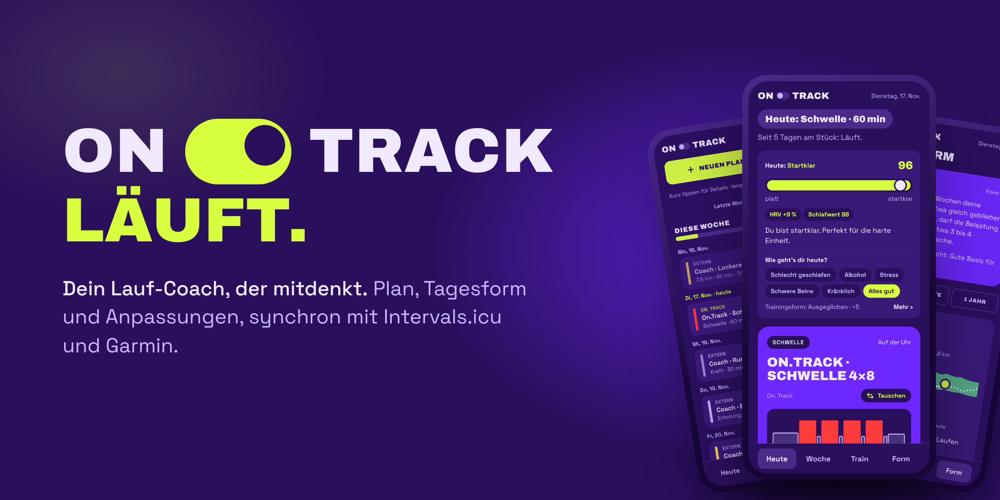
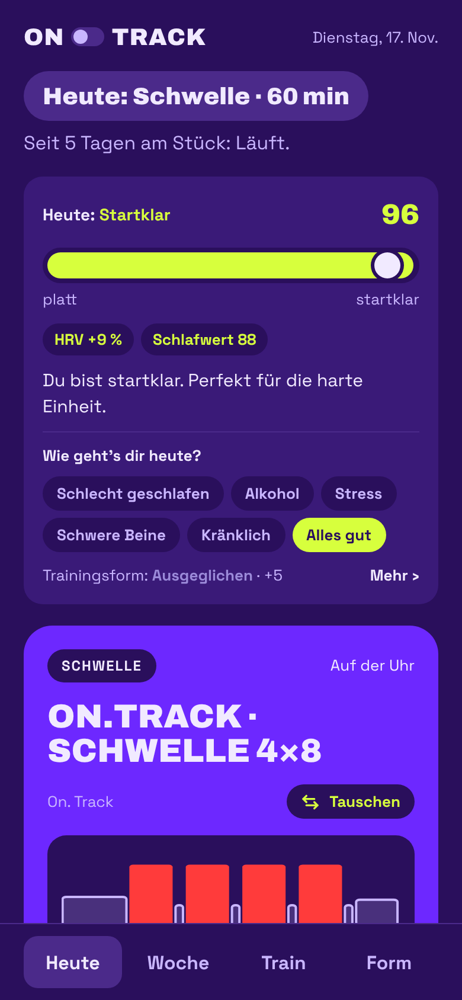
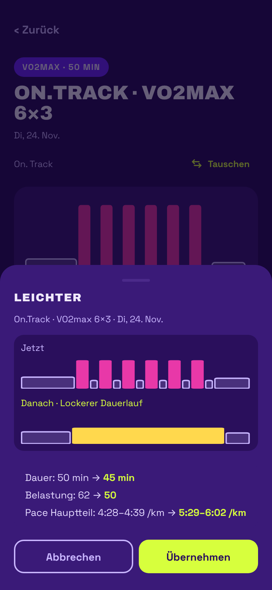
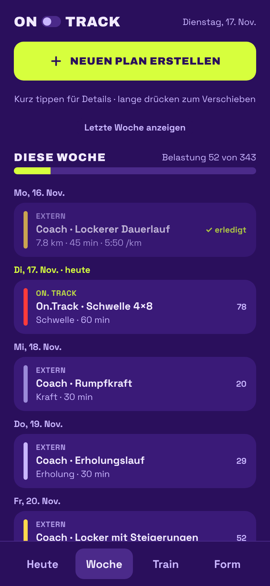

<a href="https://alxwll.github.io/ontrack/about/"></a>

<p align="center">
<a href="https://alxwll.github.io/ontrack/about/"><b>→ Zur Landingpage</b></a> &nbsp;·&nbsp;
<a href="https://alxwll.github.io/ontrack/"><b>App öffnen</b></a>
</p>

<p align="center">Trainingsplan, Tagesform und Anpassungen in einer App,<br>synchron mit Intervals.icu und direkt auf der Garmin-Uhr.</p>

<p align="center">




</p>

<p align="center"><sub>Alle Screenshots zeigen erfundene Demo-Daten.</sub></p>

---

### ⚡ Was sie kann

☀️ **Bereitschaft statt Bauchgefühl:** 0 bis 100 aus HRV, Ruhepuls, Schlaf und Form, dazu ein Check-in für das, was die Uhr nicht weiß.

🐢 **Leichter heißt schlauer:** Jede Änderung mit Vorschau. Aus VO2max-Intervallen wird ein lockerer Dauerlauf statt nur langsamer Intervalle.

🗓️ **Verschieben wie im Kalender:** lange drücken und ziehen, mit Ampel bei Kollisionen und automatischem Ausgleich.

🎲 **Train now:** Dauer wählen, die App schlägt das passende Workout vor. Dahinter stecken 37 Workouts in neun Kategorien.

📈 **Wachsen im grünen Band:** Laufaufbau mit Soll-Band und Trainingsform in Klartext, für 6 Wochen bis 1 Jahr.

🎯 **Ein Ziel, ein ehrlicher Plan:** 5 km bis Marathon, 2 bis 6 Lauftage, langer Lauf an jedem Wochentag und Warnungen, wenn der Plan zu viel will.

🗨️ **Coach:** Fragen zu Läufen und Form, Debrief nach jedem Lauf und Trainings auf Zuruf. Wahlweise mit Gemini, Groq, OpenRouter, ChatGPT oder Claude, mit automatischem Rückfall.

🔁 **Zurück auf die Uhr:** Änderungen landen als strukturierte Workouts in Intervals.icu und auf der Garmin. Fremde Pläne bleiben unangetastet.

---

<details>
<summary><b>🛠️ Technik und selbst bauen</b></summary>

<br>

- **App:** eine HTML-Datei in Vanilla JS, als PWA installierbar, gehostet über GitHub Pages
- **Server:** Cloudflare Worker, der den Intervals-Key verwahrt und nur mit Zugangscode antwortet
- **Datenfluss:** Garmin → Intervals.icu → Worker → App, und denselben Weg zurück

```
web/index.src.html   App: Ansichten, Zustand, Workout-Logik
web/features.js      Bereitschaft, Form, Bibliothek, Train now, Planer, Sync
worker/src/index.js  Cloudflare Worker (Snapshot lesen, Events schreiben)
build.py             baut index.html, optional mit eingebetteten Daten
about/               Landingpage
docs/                Banner und Screenshots
```

**App bauen**

```
python3 build.py empty_snapshot.json https://<dein-worker>.workers.dev index.html
```

**Server einrichten** (einmalig, ca. 15 Minuten)

1. Kostenloses Konto bei Cloudflare anlegen.
2. Node.js installieren, dann im Ordner `worker/`:
   ```
   npx wrangler login
   npx wrangler secret put INTERVALS_API_KEY   # Key aus Intervals.icu
   npx wrangler secret put APP_TOKEN           # selbst ausgedachter, langer Zugangscode
   npx wrangler deploy
   ```
3. Die angezeigte Adresse beim Bauen als zweites Argument angeben.
4. App hosten, z. B. mit GitHub Pages. Beim ersten Öffnen fragt sie einmal nach dem Zugangscode.
5. In den Worker-Variablen `ALLOWED_ORIGIN` auf die Adresse der App setzen und erneut deployen.

**Coach aktivieren** (optional)

1. In Cloudflare unter Storage & Databases → KV einen Namespace anlegen, z. B. `ontrack-ai`.
2. Im Worker unter Settings → Bindings eine KV-Bindung mit dem Namen `AI` auf diesen Namespace hinzufügen und deployen.
3. In der App im Tab Coach auf ⚙︎ tippen und einen Key für Gemini, Groq, OpenRouter, ChatGPT oder Claude eintragen. Er wird nur auf dem Server gespeichert.

</details>

<p align="center"><sub>Gebaut von Alex in Stuttgart · Als Nächstes: ganzen Plan nach Intervals übernehmen, Soll-Band aus dem eigenen Plan, KI-Debrief nach jedem Lauf</sub></p>
