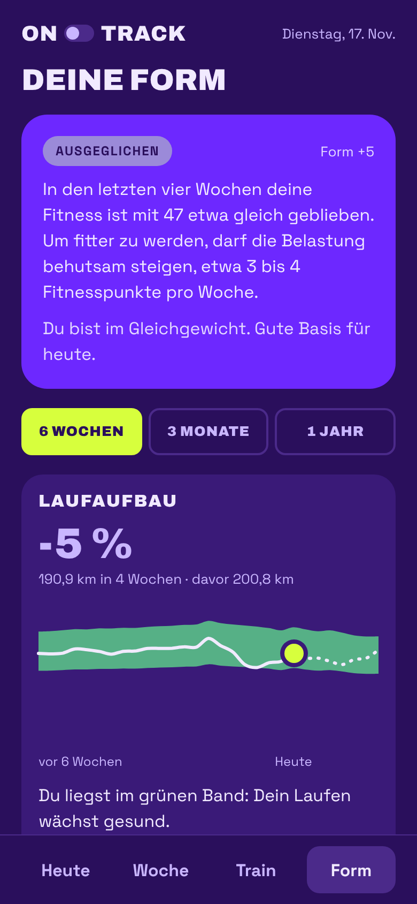
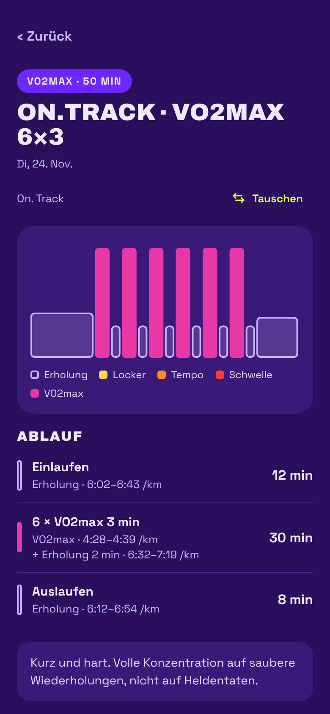
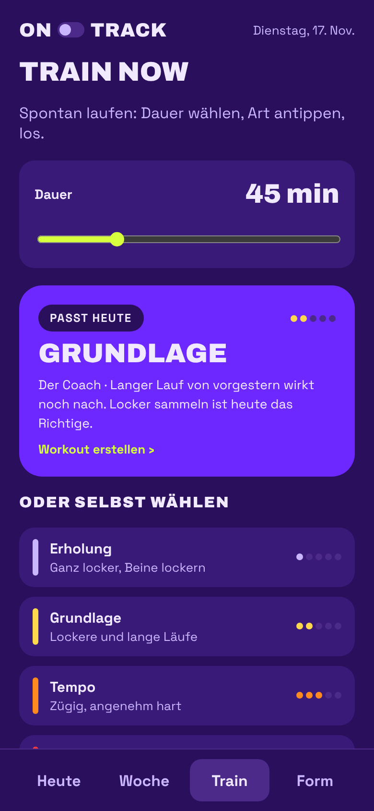
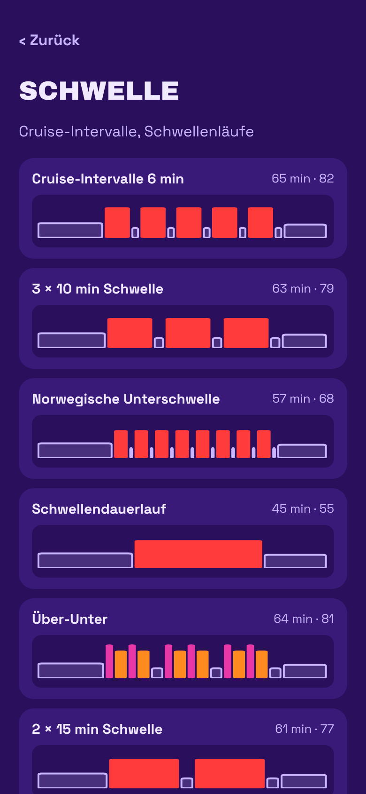
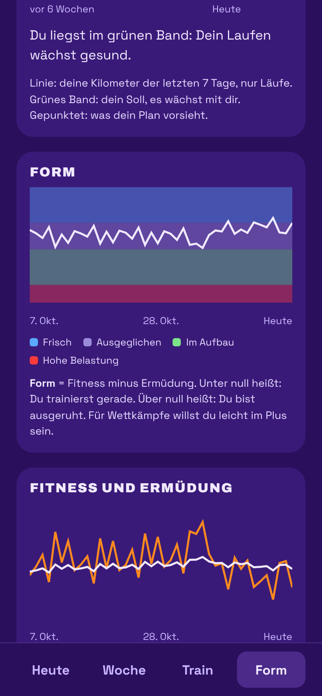
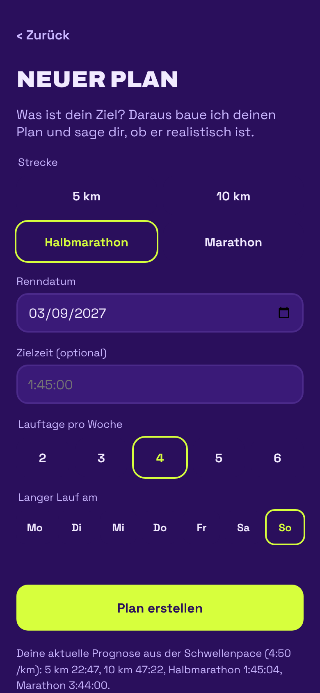
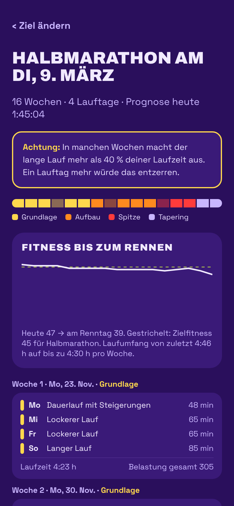

<p align="center"></p>

<h1 align="center">ON. TRACK</h1>

<p align="center"><b>Mein eigener Lauf-Coach fürs Handy.</b><br>
Trainingsplan, Tagesform und Anpassungen in einer App, synchron mit Intervals.icu und der Garmin-Uhr.</p>

<p align="center"><a href="https://alxwll.github.io/ontrack/">App öffnen</a> · gebaut für mich, offen für mehr</p>

<p align="center">
&nbsp;
&nbsp;

</p>

<p align="center"><sub>Alle Screenshots zeigen erfundene Demo-Daten.</sub></p>

---

## Die Idee

Trainings-Apps wie Runna oder Trait machen vieles richtig: klare Pläne, schöne Grafiken, einfaches Verschieben. Aber sie kennen meine Garmin-Daten nur halb, und mein Coach-Plan aus Intervals.icu lebt woanders. **On. Track** bringt beides zusammen: Es liest den Plan, die Läufe und die Erholungswerte aus Intervals.icu, macht sie verständlich und schreibt Änderungen zurück bis auf die Uhr.

Der Name ist Programm: Der Schalter im Logo steht für „Läuft“ oder eben nicht, und die App hilft dabei, auf Kurs zu bleiben.

## Funktionen

### ☀️ Heute: Bereitschaft statt Bauchgefühl

<p align="center"></p>

- **Bereitschaft von 0 bis 100**, berechnet aus HRV und Ruhepuls im Vergleich zum 30-Tage-Schnitt, Schlafdauer bzw. Garmin-Schlafwert und der Trainingsform
- **Gründe als Chips**, z. B. „HRV −27 %“ oder „4,8 h Schlaf“, und ein klarer Satz im Coaching-Ton
- **Morgen-Check-in** für das, was die Uhr nicht weiß: schlecht geschlafen, Alkohol, Stress, schwere Beine, kränklich
- Ist die Bereitschaft niedrig und eine harte Einheit steht an, schlägt die App die **leichte Variante** vor
- Das heutige Training mit Profilgrafik, Quelle (eigener Plan oder Coach) und „Heute nicht fit“

### 🗓️ Woche: verschieben wie im Kalender

<p align="center"></p>

- **Lange drücken und ziehen** (mit Vibration) oder antippen und einen Tag wählen, auch über mehrere Wochen
- **Ampel beim Verschieben**: grün passt, gelb mit Hinweis, rot kollidiert mit einer harten Einheit
- **Ausgleich**: Fällt Belastung weg, wandert ein Teil als lockerer Umfang in den nächsten passenden Lauf, gedeckelt auf +15 %
- Erledigte Läufe mit Kilometern und Pace, Wochenbelastung als Balken

### 🔍 Details und Anpassen mit Vorschau

<p align="center">&nbsp;</p>

- **Profilgrafik und Ablauf** aus den echten Workout-Schritten, Pace-Bereiche aus der eigenen Schwellenpace
- **Leichter, Kürzer, Schwerer, Länger**: Jede Änderung zeigt erst eine **Vorschau** (vorher/nachher, Dauer, Belastung, Pace) und wird erst nach „Übernehmen“ aktiv
- **„Leichter“ denkt mit**: Aus Sprints und VO2max-Intervallen wird ein lockerer Dauerlauf statt nur langsamerer Intervalle. Schwelle und Tempo werden ruhiger und kürzer.
- **Tauschen** gegen jedes Workout aus der Bibliothek, auch über Kategorien hinweg
- **Original wiederherstellen** mit einem Tipp

### ⚡ Train now und Workout-Bibliothek

<p align="center">&nbsp;</p>

- **Train now**: Dauer wählen, die App schlägt anhand von Bereitschaft und letzten Einheiten die passende Art vor, und das Workout geht direkt auf die Uhr
- **Bibliothek mit 37 Workouts** in neun Kategorien: Erholung, Grundlage, Tempo, Schwelle, Berg, VO2max, Speed, Wettkampf und Tests
- Jedes Workout passt sich an die gewünschte Dauer an, ohne die Kernintervalle zu verwässern

### 📈 Form und Laufaufbau

<p align="center">&nbsp;</p>

- **Trainingsform** (Fitness minus Ermüdung) in fünf Zonen von „Sehr erholt“ bis „Hohe Belastung“, mit Erklärung in Klartext
- **Laufaufbau**: Kilometer der letzten 7 Tage als Kurve, ein grünes **Soll-Band** aus dem eigenen Schnitt und die geplanten Kilometer gepunktet. Oben steht die Veränderung zu den vier Wochen davor in Prozent.
- Zeiträume **6 Wochen, 3 Monate, 1 Jahr**; zum Wischen über die Grafik gibt es Werte pro Tag

### 🎯 Plan erstellen

<p align="center">&nbsp;</p>

- Ziel wählen: **5 km, 10 km, Halbmarathon oder Marathon**, Renndatum und optional eine Zielzeit
- **2 bis 6 Lauftage**, langer Lauf an jedem Wochentag. Die übrigen Einheiten verteilt der Planer so, dass harte Tage nie direkt aufeinander folgen.
- Phasen **Grundlage, Aufbau, Spitze, Tapering**, höchstens 10 % mehr pro Woche, jede vierte Woche leichter
- **Ehrliche Warnungen**, wenn der Plan zu viel will: zu wenig Wochen, zu steile Steigerung, Zielzeit weit weg von der Prognose oder zu wenig Lauftage für die Strecke
- Prognose aus der Schwellenpace und eine Fitness-Zielkurve bis zum Renntag

## Zusammenspiel mit anderen Plänen

On. Track arbeitet neben einem bestehenden Coach-Plan (bei mir IntervalCoach). **Fremde Einheiten bleiben unangetastet**, solange ich sie nicht selbst ändere. Automatische Anpassungen wie Ausgleich oder Entschärfen nach einem kranken Tag laufen nur bei eigenen On.Track-Einheiten. Erkennbar sind sie am Namen `On.Track · …`.

## Technik

- **App**: eine einzige HTML-Datei in Vanilla JS, ohne Framework, als PWA installierbar. Gehostet über GitHub Pages.
- **Server**: ein kleiner Cloudflare Worker, der den Intervals-Key sicher verwahrt und nur mit dem eigenen Zugangscode antwortet
- **Datenfluss**: Garmin → Intervals.icu → Worker → App, und für Änderungen denselben Weg zurück bis auf die Uhr
- **Zurückschreiben**: Verschieben, Anpassen, Tauschen, Streichen und neue Workouts landen als strukturierte Workouts in Intervals.icu und damit auf der Garmin

```
web/index.src.html   App: Ansichten, Zustand, Workout-Logik
web/features.js      Bereitschaft, Form, Bibliothek, Train now, Planer, Sync
worker/src/index.js  Cloudflare Worker (Snapshot lesen, Events schreiben)
build.py             baut index.html, optional mit eingebetteten Daten
docs/screens/        Screenshots für diese Seite
```

## Selbst bauen

```
python3 build.py empty_snapshot.json https://<dein-worker>.workers.dev index.html
```

### Server einrichten (einmalig, ca. 15 Minuten)

1. Kostenloses Konto bei Cloudflare anlegen.
2. Node.js installieren, dann im Ordner `worker/`:
   ```
   npx wrangler login
   npx wrangler secret put INTERVALS_API_KEY   # Key aus Intervals.icu
   npx wrangler secret put APP_TOKEN           # selbst ausgedachter, langer Zugangscode
   npx wrangler deploy
   ```
3. Die angezeigte Adresse (`https://ontrack.<name>.workers.dev`) beim Bauen als zweites Argument angeben.
4. App hosten, z. B. mit GitHub Pages. Beim ersten Öffnen fragt sie einmal nach dem Zugangscode.
5. In den Worker-Variablen `ALLOWED_ORIGIN` auf die Adresse der App setzen und erneut deployen.

## Als Nächstes

- Ganzen Plan mit einem Tipp nach Intervals übernehmen
- Soll-Band im Laufaufbau direkt aus dem eigenen Plan ableiten
- KI-Debrief nach jedem Lauf und ein Wochenrückblick
